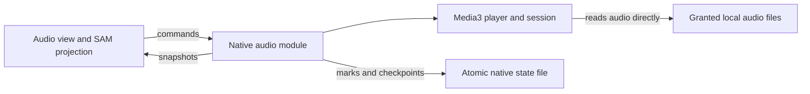

# Audio library in Notes

Status: production library implemented after phone storage and playback tests in
signed builds 59 and 60. On 22 October the user authorized proceeding with the
complete feature and waived further manual testing before delivery. Remaining
phone checks are unverified, not passing.
Current implementation and test evidence: `AUDIO-VALIDATION.md`.
Date: 22 October 2026.
**Delivery decision:** the user waived the remaining manual gates (including the
one-week trial) before this production release. Implement all requested actions,
run automated regression/build checks, and publish the signed update. Preserve
the manual protocol below as deferred checks; do not claim those observations.

Source baseline inspected: `54fe3dcd101a2fb050ca4f7eff495d8ad7c6d04f`.

## Outcome

Open Notes, choose an already downloaded recording, listen with the screen locked,
resume later, mark it done, and delete its download when finished.
The library should make a finite collection easier to use and clear.

The first release includes all four requested actions: **see, play, mark done,
and delete**.
A foreground-only demonstration or a delete button that merely hides a row is
not the completed feature.

Downloads, content selection and delivery remain with the existing workflow.
The app reads the phone's completed files; it does not download from YouTube,
subscribe to feeds, contact the media server, or manage torrents.
No recommendations, autoplay, streaks, browsing feed or consumption targets.

## Current implementation and constraints

- `src/model.ts`, `src/loop.ts` and `src/view.ts` implement the SAM loop and modes.
  Actions produce proposals; the model and loop own their documented mutations.
- `src/media.ts` and `src/attachments.ts` handle vault image/video attachments.
  They are not an external audio library and must not receive long recordings
  as base64 blobs or GitHub attachments.
- Android is Capacitor with Java plugins registered in `MainActivity.java`.
  Existing plugin patterns include `AlarmPlugin` and `BeeperPlugin`.
- `android/variables.gradle` targets SDK 36 with minimum SDK 24. The reviewed
  baseline had no playback service or Media3 dependency; the native spike now
  adds these. See `AUDIO-VALIDATION.md` for delivered builds and remaining gates.
- `DECISIONS.md` requires small interfaces, typed failures, files as durable
  truth, and effects outside pure presentation.
  Its historical descriptions must be checked against current source.
- The media workflow already supplies Opus recordings and an M4B audiobook.
  The server's media share is send-only. The phone reports Android 17 (API 37),
  Send & Receive and empty ignore patterns; Ignore Delete is not shown and its
  value is unknown. Its persisted local SAF read/write grant is confirmed.
  Server settings alone cannot establish safe phone deletion.
- `.github/workflows/android-apk.yml` builds and publishes an APK on pushes to
  `main`, including documentation-only pushes under its current trigger.

This plan contains no user media inventory, credentials, device identifiers or
private vault contents.
The app repository and the private notes vault remain separate.

## Product behaviour

### Setup and library

Add one **Audio** mode and one folder-selection action in its empty state.
On Android, select the local `phone-media` folder through the system picker.
Remember the granted content URI, not an assumed `/storage/...` path.
Only enumerate audio beneath `youtube/`, `podcasts/` and `audiobooks/`.
Do not touch `video/`, recordings elsewhere on the phone, or Syncthing internals.

Show **Unplayed / In progress / Done** with an optional source filter.
Each row shows a title, channel/author when present in local metadata or the
existing filename, duration, progress and available actions.
Use a stable title/path sort; downloads must not reorder the list on every paint.
Keep duplicate titles distinct by relative path.
Metadata extraction uses local files only and never fabricates an author.

Opus and M4B are required because they cover the existing download workflow.
M4A and MP3 are additional first-release formats only after codec/container
qualification on the real phone; list the actual supported combinations.
Exclude hidden files, `.syncthing.*`, `.stversions`, conflict copies and partial
extensions before probing.
Syncthing normally publishes final files by moving completed temporary files
into place; a failed probe remains an actionable file error, not a playable row.

Refresh on entering Audio, returning to the foreground, and explicit Refresh.
Keep the last successful listing if a refresh fails.
Perform enumeration, metadata extraction and any hashing away from the UI thread,
with bounded work and cancellation when changing the selected root.
No permanent polling scan of the whole phone.

### Playback and completion

Tap Play to start or resume one item.
Show a small persistent player across Notes modes with play/pause, elapsed and
remaining time, a seek control, back 15 seconds and forward 30 seconds.
One item plays at a time; starting another checkpoints and replaces the first.
Navigation, editing notes and closing the WebView must not create another player.

Playback must continue with the screen locked and support Android media controls
and headset play/pause.
Headphone removal pauses rather than switching speech to the speaker.
An interruption must not restart an item the user subsequently paused.
Resume after a process restart or reboot requires an explicit Play action.
An actual Android force-stop is not a promise of continuing playback.
Starting Notes, scanning files or syncing notes never starts audio or a playback
foreground service. Foreground playback starts from an explicit user action.
Test an ordinary Activity recreation and swipe from Recents separately from a
force-stop; the WebView's lifetime is not the player's lifetime.

| Action/event | Listening state | Files |
| --- | --- | --- |
| First Play | In progress | Retained |
| Pause, seek or leave Audio | Keep In progress and bookmark | Retained |
| Natural end | Done, retain final bookmark | Retained |
| Mark done | Done; pause if this is the playing item | Retained |
| Mark unplayed | Unplayed; pause if active and reset bookmark/player position | Retained |
| Play again on a Done item | In progress, restart at zero | Retained |
| Delete download | Keep listening state/history | Delete only the selected local download |

Finishing an item stops playback; it never starts the next one.
Mark done does not delete, and deleting does not imply the recording was heard.
Changing the selected root pauses the current item before releasing its grant.

### Delete means removing bytes

Use **Delete download** with a confirmation naming the item and its size.
Explain that this removes this phone's download and retains listening history.
There is no trash promise or automatic undo for physical deletion.
Cancel changes nothing.

On confirmation, pause/release the selected item if active, persist a deletion
intent, revalidate its identity and write grant, delete the document, verify its
absence through a successful provider query, and durably record the result before
showing success.
An access error is not evidence of absence.
Deletion is serialized with play/root-change operations for that item.
Retries target the exact same file version; they must not delete replacement
content delivered later at the same path.

An already absent item resolves idempotently to absent.
A read-only provider, revoked permission, changed identity or failed delete keeps
an honest failed/pending state with a retry or reselect action.
Keep Done rows visible as history when their local download is absent.
Rows without local bytes say Not downloaded on this phone and cannot Play.
Retain all recorded marks even if a file was removed outside Notes.
Never delete another directory, the server copy, a seeding copy, a note, or a
whole share as a side effect.
If the process dies after deletion but before acknowledgment, recovery checks
whether the exact document is absent or has changed before completing the intent.
It never blindly replays deletion against a reused path.

#### Syncthing compatibility gate

**22 October user override:** proceed with the full production library, including
version-bound local document deletion, using the existing share configuration.
The following original acceptance protocol remains a record of unexecuted checks,
not a hold on implementation or delivery. No ignore rules or share settings are
changed. Persistence of phone deletion across Syncthing reconnect/rescan/restart
and preservation of server bytes after an actual phone deletion remain unverified.
If a download returns, surface it normally; never conceal restored bytes.

Do not assume send-only mode or Ignore Delete solves local deletion.
Syncthing can preserve local changes, report them, or restore cluster content
through subsequent operations depending on the phone's configuration.
Never use **Override Changes** or **Revert Local Changes** as cleanup actions.

The first storage spike must prove that a deliberately deleted phone download
stays absent across rescan, reconnect and restart while its server copy remains.
Inspect the phone's actual configuration and document the tested behaviour.
Use disposable copies of representative audio for this test.

If ordinary document deletion does not satisfy that gate, stop before building
the full UI and refine the delivery integration.
The preferred fallback to investigate is an exact per-file phone-side ignore
rule, installed before deletion, preserving every unrelated rule and file.
Do not silently change share direction, enable cleanup timers, install broad
ignore patterns, or introduce a remote deletion worker.
The choice and its failure recovery need a tested successor to this plan before
implementation proceeds; hiding a restored download is not a substitute.

The gate has three explicit outcomes:

| Observation | Decision |
| --- | --- |
| Ordinary deletion passes every reconnect/rescan/restart check | Use the existing share configuration and document its expected local-change reporting |
| A deleted download returns, or phone changes propagate outside the intended scope | Do not ship that implementation; prove narrowly scoped selective exclusion and recovery before continuing |
| The phone/provider/settings cannot be inspected or tested | Record the gate as unverified; do not call the complete feature ready |

Configuration changes that intentionally restore local changes can restore a
download; that is outside an ordinary rescan/reconnect guarantee and must be
explained in the tested setup record.

## State, identity and durability

Three independent facts describe an item:

- **Listening:** Unplayed, In progress or Done.
- **Availability:** present, missing or unreadable.
- **Operation:** idle, preparing or deleting, with a typed failure when needed.

Do not overload one status with all three.
Missing files must not reset Done marks, and temporarily lost permission must
not be interpreted as all files having been deleted.

Use a root binding plus normalized relative path as the logical item location.
Before playback/deletion binds a durable item, obtain a content fingerprint
off the UI thread and associate it with the provider document identity.
The durable version includes a content SHA-256; cached size/mtime are only hints.
Check metadata before and after hashing; discard unstable reads and retry after
the file settles.
Resolve identity on first play, mark or delete, so marking a never-played row
also refers to a specific file version.
Revalidate the version when reopening a file, and rehash before deletion.
Do not rehash on every progress tick, seek or library paint.
A replacement at the same path gets a new version and no inherited bookmark.
A rename is a new location in v1; identical titles or identical bytes at different
locations are not merged implicitly.
No root-wide hash pass may block the first library paint.
Until a version is identified, the row can show metadata and Preparing rather
than pretending a command is already saved.
Hash work is cancellable, bounded to one file at a time, and cannot block Pause.
Retain known item metadata alongside history so absent Done items remain legible.

The native audio module owns playback position and listening state, including
while JavaScript is suspended.
Persist a small, versioned JSON file atomically in app-private storage, with a
single serialized writer and a recoverable prior version.
It holds bindings, known item versions, bookmarks, marks and deletion intents;
the audio bytes remain in external storage.
Never persist playback as `isPlaying=true` and restart it on boot.

Checkpoint every 15 seconds while playing and immediately on pause,
seek, item change, completion, mark change and before a destructive operation.
At most the uncheckpointed interval can be lost on abrupt process death.
An acknowledged mark or completed deletion must already be durable.
If persistence fails, report that failure and do not claim a saved mark or start
a destructive operation whose intent cannot be recovered.
Recovering an older checkpoint after corruption must report that recovery;
it must not silently promise the latest bookmark survived.
Unknown schema versions and corrupt deletion intents disable destructive replay
until reconciled, without deleting the original state file.

This is deliberately **device-local player state**, not a new vault sync model.
The JSON file is durable truth; IndexedDB and the rendered model are projections.
App updates retain it; clearing app data or uninstalling can discard it.
External audio remains outside the app's uninstall lifetime.
Do not claim cross-device progress, recovery from uninstall, or importing
AntennaPod's listening history in v1.
Record this extension of the native-state policy in `DECISIONS.md` during
implementation; leave the existing Markdown note/outbox rules intact.

Every native snapshot carries a playback-module epoch, root generation and a
monotonically increasing revision within that epoch.
A new native process establishes a new epoch in the connection handshake;
an old callback cannot change epochs by itself.
This avoids treating a post-restart revision counter as permanently stale.
Subscribe before acquiring the initial snapshot and order both through the same
revision checks, so an intervening update is not lost.
WebView reconnection reconciles complete native state rather than replaying its
cached commands or resetting the player from an old rendered model.

## Implementation shape

Only metadata and commands cross the JS seam; audio bytes stay native.

### Native audio module

Use Android Media3 ExoPlayer with one `MediaSessionService` owning the player.
The Capacitor plugin connects to it; the Activity does not own player lifetime.
Choose and pin compatible stable Media3 artifacts at implementation time,
keeping their versions aligned and checking the current SDK/Capacitor build.
Java classes are justified where Android/Capacitor require them.
The externally visible MediaSession supports ordinary playback controls only.
Reject arbitrary caller-supplied media URIs and unknown media identifiers through
session callbacks as well as the Capacitor interface; deletion is not a media
session command.

Use Storage Access Framework tree grants and persist the allowed read/write
permissions; handle refusal, revocation, missing roots and read-only providers.
Restrict the initial implementation to the phone's local documents provider;
cloud-backed/virtual documents are outside the offline playback contract.
Validate ancestry through document identifiers, not a guessed filesystem path.
Do not request all-files access or transfer audio bytes through the JS bridge.

The small interface exposes folder selection, refresh/snapshot, a typed command
and snapshot subscription.
Commands are play, pause, seek, mark and delete; they use opaque item/version
identifiers minted by native enumeration, not caller-supplied paths or URIs.
Serialize commands and revalidate the item at execution.
Include the expected epoch/root generation and item version on commands, return
an operation identifier and durable acknowledgment, and reject stale targets.
Metadata/hash work finishes asynchronously; apply its result only if its command
and root generation are still current.
Clamp seek positions to a valid known duration; refuse seeking when unavailable.
Keep provider access, checkpoint recovery, parsing and Media3 details behind
that interface, with internal seams for deterministic tests.

Use the playback foreground-service declarations and notification required by
the target Android version.
Let Media3 manage ordinary audio focus, with speech-appropriate attributes.
The existing Notes alarm path is notification-based: prove alarms remain audible
and pause audio explicitly when a Notes alarm rings if focus alone does not.
Do not change alarm scheduling, volume policy or dismissal semantics to make
the player test pass.
Release descriptors and controllers on their actual lifecycle boundaries.

### Web layer

- `src/audio.ts`: native and unsupported-browser adapters, parsed snapshots,
  typed commands/results and test fakes at the same interface.
- `src/view-audio.ts`: library, filters, empty/error states and compact player.
- `src/model.ts`: Audio mode and immutable audio projection.
- `src/loop.ts`: injected audio dependency, command effects returning proposals,
  subscription lifecycle and snapshot revision checks.
- `src/view.ts`, `src/main.ts`, `src/style.css`: navigation, wiring and layout.
- Android: `AudioPlugin`, `AudioPlaybackService`, and focused library/state-file
  helpers; register the plugin, declare the playback service/permissions and add
  the aligned Media3 dependencies in `android/app/build.gradle`.
- `DECISIONS.md`: record the player-state file's ownership/lifetime and tested
  deletion policy as prospective decisions, without rewriting historical claims.

Names are proposed touch points, not a request to spread one rule across files.
Keep audio discovery separate from `src/media.ts`'s vault attachment cache.
Views issue intentions; they never delete files or mutate model state directly.
Failures distinguish permission, missing/version-changed file, unsupported media,
storage write failure, decode/playback failure and cancelled setup.

The browser/PWA remains fully usable for notes and tasks.
It does not show a fake phone library, request a server token or promise access
to Android files; gate the Audio entry to supported native builds.

## Delivery order and evidence

| Step | Work | Exit gate |
| --- | --- | --- |
| 1. Storage/deletion spike | Select actual local tree; enumerate, fingerprint and delete disposable audio; inspect phone Syncthing settings | Local access survives reboot; deletion survives rescan/reconnect/restart; server and unrelated files unchanged, or a documented integration redesign before continuing |
| 2. Native playback/durability spike | One Opus and one M4B through Media3, native checkpoint file and recovered marks | Locked-screen playback, headset controls, cold-start explicit resume, force-stop recovery and Notes alarm coexistence demonstrated |
| 3. Library and controls | Implement the Audio mode, filters, compact player and mark semantics through the native interface | Complete offline see/play/done/delete journey, including cancellation and failed actions |
| 4. Qualification and release | Regression checks, signed APK, actual-phone acceptance and one-week usability trial | All requested actions pass, evidence identifies the exact build, then assess whether listening/clearing is easier |

Use a task worktree for implementation under the shared workspace layout.
Retain existing signing identity, application ID and update route.
No root access or migration of the audio library is required by this plan.
Follow the shared host compute policy for builds and tracked long jobs.
Do not run an installer or modify a live Syncthing share merely to write this plan.

### Automated checks during implementation

- Through the audio interface: state transitions, duplicate titles, replacement
  versions, stable refresh, stale events/commands, epoch changes, cancelled setup
  and unsupported web. Include the subscribe/initial-snapshot race.
- Native internal seams: checkpoint atomicity/recovery, corrupt and future schema
  versions, write failure, permission loss, idempotent deletion and changed-file
  refusal; cancellation never starts a delete. Test interruption before intent
  persistence, after intent persistence, after byte removal and before final
  acknowledgment, including a replacement file appearing between phases.
- View/loop: controls target the correct item, marking done never deletes,
  deleting never implies listened, and a render/navigation never starts playback.
- Run `bun test`, `bun run check`, `bun run build` and
  `cd android && ./gradlew testReleaseUnitTest assembleRelease --no-daemon`.
  Use the established SDK/signing workflow; record environment failures honestly.
  A green APK build is not proof of locked-screen playback or file deletion.

### Actual-phone acceptance

Test on the current unrooted phone, recording Android version, app build,
provider, phone folder settings, sample versions and results without publishing
private identifiers or media contents.

1. Grant/cancel/revoke/reselect storage access; notes still work in each case.
2. See representative Opus/M4B files offline, with correct metadata and no partial,
   hidden, video or unrelated documents. Check spaces, Unicode and duplicate titles.
3. Play, pause, seek and resume after switching modes; one player remains.
   Test a long recording and every additional advertised container/codec.
4. Lock the screen for at least 30 minutes, use headset controls, remove headphones,
   receive an interruption and ring/dismiss/snooze an existing Notes alarm.
   Cover notification permission denial and the current battery restrictions;
   never ask the user to disable alarm protections to make audio work.
5. Kill the process, reboot, update the app and cold-open: no surprise playback,
   durable marks intact and resume within the last checkpoint interval.
6. Mark done/unplayed, finish naturally and play again; verify the transition table
   and no next-item autoplay. Repeat marks while the WebView is disconnected.
7. Cancel and confirm deletion of both active and inactive disposable items.
   Check actual byte removal and retained history, then rescan/reconnect/restart
   Syncthing and the phone. Server originals and unrelated notes/media stay intact.
8. Replace a file while an old action is pending; the old action cannot delete or
   apply its bookmark to the replacement. Lose permission/write access mid-action
   and interrupt each persisted deletion phase; recovery reports the true outcome.
9. Leave Audio and exercise editing, task alarms, note sync and APK updating.
   Browser note use stays unchanged. AntennaPod and its data remain available
   until the feature has passed the complete phone journey.

## Plan refinement record

Three passes by the same planning agent; these are document reviews, not
independent product reviews or executed device tests.

| Pass | Review focus | Resulting refinement |
| --- | --- | --- |
| 1 | Ground the proposal in the source and actual media delivery | Kept external audio out of GitHub attachments; chose one native player with a small interface; made all four requested actions mandatory |
| 2 | Walk crashes, stale callbacks and replacement files through the design | Added epoch/root/revision ordering, subscribe/snapshot reconciliation, version-bound deletion recovery, durable acknowledgments, and explicit checkpoint/corruption behaviour |
| 3 | Check scope, platform constraints and whether release claims are testable | Required current Opus/M4B playback, separated Activity destruction from force-stop, covered Notes alarm coexistence, made Syncthing deletion a decision gate, and kept browser support/remote deletion out of scope |

The unresolved facts are device observations with named evidence gates:
storage-provider capabilities, the phone's current Syncthing behaviour, and
playback/permission behaviour on its installed Android version.
They do not authorize dropping deletion or background playback from the outcome.
No additional product decision is required before starting the two spikes.
If those experiments contradict a design assumption, revise this document using
their evidence before committing to the full implementation.

The implementation gates above are future work, not tests already executed.
This planning change performs no audio import, physical deletion or app release.

## Sources

- Local baseline: `DECISIONS.md`, `src/{model,loop,media,attachments}.ts`, Android
  manifest/plugins/build files and `.github/workflows/android-apk.yml`.
- [Android: background playback](https://developer.android.com/media/media3/session/background-playback).
- [Android: audio focus](https://developer.android.com/media/optimize/audio-focus).
- [Android: user-selected files and persistent permissions](https://developer.android.com/training/data-storage/shared/documents-files).
- [Syncthing: folder types](https://docs.syncthing.net/users/foldertypes.html).
- [Syncthing: synchronization and temporary files](https://docs.syncthing.net/users/syncing.html).
- [Syncthing: ignore patterns](https://docs.syncthing.net/users/ignoring.html).
